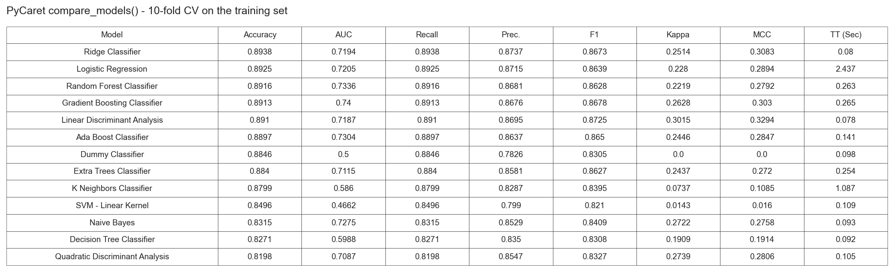
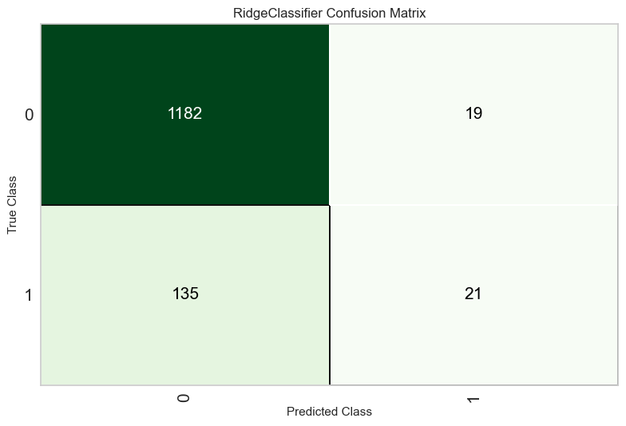
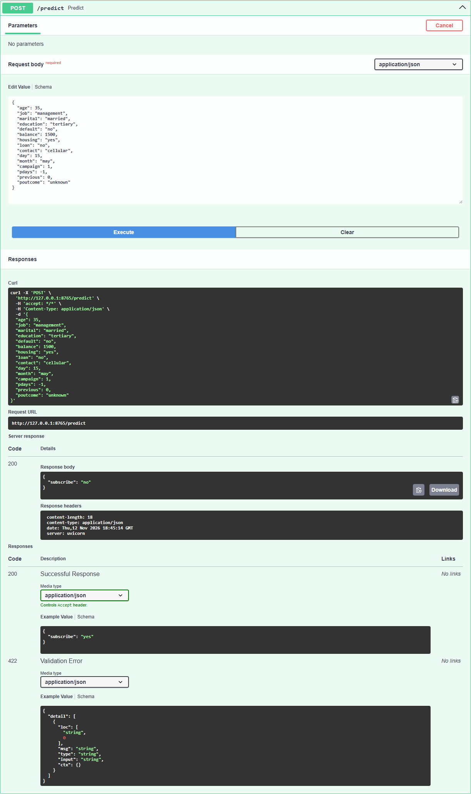

# Term Deposit Prediction: PyCaret vs scikit-learn, served with FastAPI

## Business problem and dataset

A Portuguese bank sells term deposits by phone. Calling every client is expensive, so the bank wants to predict, **before calling**, which clients are likely to subscribe (`y` = yes/no) and prioritise those calls.

**Dataset:** [Bank Marketing, UCI Machine Learning Repository](https://archive.ics.uci.edu/dataset/222/bank+marketing) (Moro, Cortez & Rita, 2014). I use `bank.csv`, the official 10% sample of the full data: **4,521 rows, 16 original features, and 15 model features after dropping duration** (6 numeric and 9 categorical, e.g. `job`, `marital`, `education`, `contact`, `poutcome`). It is saved as `data/bank.csv`, converted from semicolon-separated to comma-separated. The classes are imbalanced: 88.5% `no` and 11.5% `yes`. There are no empty cells; the categorical value `unknown` is retained as an explicit category.

**Dropped columns**

| Column | Why |
|---|---|
| `duration` | The length of the last call in seconds. It is only known **after** the call ends, and the UCI page itself warns that it nearly determines the outcome (a 0-second call is always a "no"). Keeping it would leak the answer and make the model useless for deciding whom to call. |

The dataset has no ID column. I kept every other column because the bank knows it before dialling: client details, the planned contact date (`day`, `month`), how many times the client has been contacted this campaign, and the history from previous campaigns (`pdays`, `previous`, `poutcome`).

## How to run

Requires [uv](https://docs.astral.sh/uv/). Python 3.11 is pinned, because PyCaret 3.3 does not support newer versions.

```bash
git clone https://github.com/advikarathi/assignment-2.git
cd ml-pipeline
uv run discovery.py          # both workflows; writes images/ and model.joblib (about 1 minute for training; first-time installation and imports take longer)
uv run fastapi dev main.py   # API at http://127.0.0.1:8000/docs
```

If port 8000 is already in use, run `uv run fastapi dev main.py --port 8765`.

## Part 2: Workflow comparison

### PyCaret

`setup(data=df, target="y", session_id=42)` followed by `compare_models(n_select=3)`. The top three models were **Ridge Classifier, Logistic Regression and Random Forest**.



The confusion matrix for the best model (Ridge) on PyCaret's 30% hold-out set:



### scikit-learn (rebuilding the Ridge Classifier)

Stratified 70/30 split → `ColumnTransformer` (median impute and `StandardScaler` for numeric columns; most-frequent impute and `OneHotEncoder` for categorical columns) → `RidgeClassifier`, all in one `Pipeline` saved to `model.joblib`.

```
              precision    recall  f1-score   support

          no     0.8975    0.9842    0.9388      1201
         yes     0.5250    0.1346    0.2143       156

    accuracy                         0.8865      1357
   macro avg     0.7112    0.5594    0.5766      1357
weighted avg     0.8547    0.8865    0.8555      1357
```

### Comparison answers

**Efficiency.** PyCaret took **60.9 s** in my final run and needed about **6 lines** of my code: import, `setup`, `compare_models`, `pull`, `plot_model`. The scikit-learn section took **0.1 s** but needed about **32 lines**: imports, split, two sub-pipelines, the `ColumnTransformer`, the `Pipeline`, the report and the save. That isn't a like-for-like timing: PyCaret trained 13 algorithms × 10 folds, while scikit-learn fit one model once. So PyCaret was more efficient for *my time* when searching for a model, and scikit-learn was more efficient at *run time* once I knew which model I wanted.

**Why the scores differ.** PyCaret reports Ridge as **accuracy 0.8938, F1 0.8673, precision 0.8737**, averaged over 10 cross-validation folds on the 70% training set. My scikit-learn report gives **accuracy 0.8865, weighted F1 0.8555, weighted precision 0.8547** on one held-out test set of 1,357 rows that the model never saw. A single test set carries sampling variation; its score can be higher or lower than the CV average. The preprocessing also differs: PyCaret does not scale numeric columns by default, and my pipeline does. Another detail: PyCaret's "Recall" column (0.8938) equals its accuracy because it is **recall weighted across both classes**, not recall of `yes`. The recall that matters here is **0.1346 for `yes`**: the model finds only 21 of 156 subscribers. PyCaret's own confusion matrix shows the same 21/156.

**Which metric matters.** **Recall on the `yes` class.** A missed subscriber is lost revenue, while an extra phone call costs only a few minutes of agent time. Accuracy is misleading here: PyCaret's Dummy Classifier, which always predicts "no", scores **0.8846**, almost the same as Ridge. On recall, this model (0.13) is not yet good enough for the business. A quick check with `class_weight="balanced"` raised `yes` recall to **0.59** (precision fell to 0.21). That is the trade-off I would choose for a call list, and it is the next step before using the model for real.

## Part 3: The API

`main.py` loads `model.joblib` once, when the app starts. A Pydantic `Client` model has one typed field per feature; categorical fields are `Literal`s, so `/docs` lists the allowed values and bad input returns a 422 error. `POST /predict` turns the JSON into a one-row DataFrame and returns `model.predict()`.

**Sample input**

```json
{
  "age": 35, "job": "management", "marital": "married", "education": "tertiary",
  "default": "no", "balance": 1500, "housing": "yes", "loan": "no",
  "contact": "cellular", "day": 15, "month": "may", "campaign": 1,
  "pdays": -1, "previous": 0, "poutcome": "unknown"
}
```

**Output**

```json
{"subscribe": "no"}
```



## Explaining a prediction

| | Input change | Prediction |
|---|---|---|
| A | the sample input above (`poutcome: "unknown"`) | `{"subscribe": "no"}` |
| B | the same, but `poutcome: "success"` | `{"subscribe": "yes"}` |

Screenshot of request B: [images/docs_prediction_yes.png](images/docs_prediction_yes.png)

**Does this make sense?** Yes. `poutcome = success` means the client said yes to the bank's previous campaign. In the data, 64.3% of those clients subscribe again, compared with 9.1% when the previous outcome is unknown. A past buyer is the warmest lead a sales team has. Other single changes I tried did not flip the prediction from "no": month = oct or mar, housing = no, a 65-year-old retiree, contact = unknown. That fits the model's low recall. Ridge only predicts "yes" when there is a very strong signal, and a previous success is the strongest one in this dataset.

This is a controlled sensitivity experiment: only `poutcome` changes. Input B is not a consistent real client history because `previous` remains 0 and `pdays` remains -1 (never contacted). It shows the model's response to one feature, not a causal effect or a deployable customer scenario. A real previously successful client would also need consistent contact-history fields.

## AI use

I made the decisions about the problem and the analysis myself: choosing the Bank Marketing dataset, dropping `duration` because it leaks the outcome, picking recall on `yes` as the metric that matters to the bank, and running the `/docs` tests and the prediction experiment. I used AI coding assistants (Claude Code, then Codex for a final check) for the boilerplate: the uv project setup, the PyCaret and scikit-learn code in `discovery.py`, the Pydantic fields in `main.py`, the helper that renders the comparison table to a PNG, and a first draft of this README. I split it this way because the boilerplate is easy to check by running it, while the judgement calls are what the assignment is actually testing, so I wanted those to be mine.

The AI output still needed checking. The clearest example: PyCaret's Recall column showed 0.89, which looked fine, until I noticed it was exactly the same as Accuracy. That is because it is recall weighted across both classes. The recall for `yes` is only 0.13, which changed my whole conclusion about the model. Another one: my first API tests returned results from a different app that was already running on port 8000, so I had to move the server to a free port and test again.
